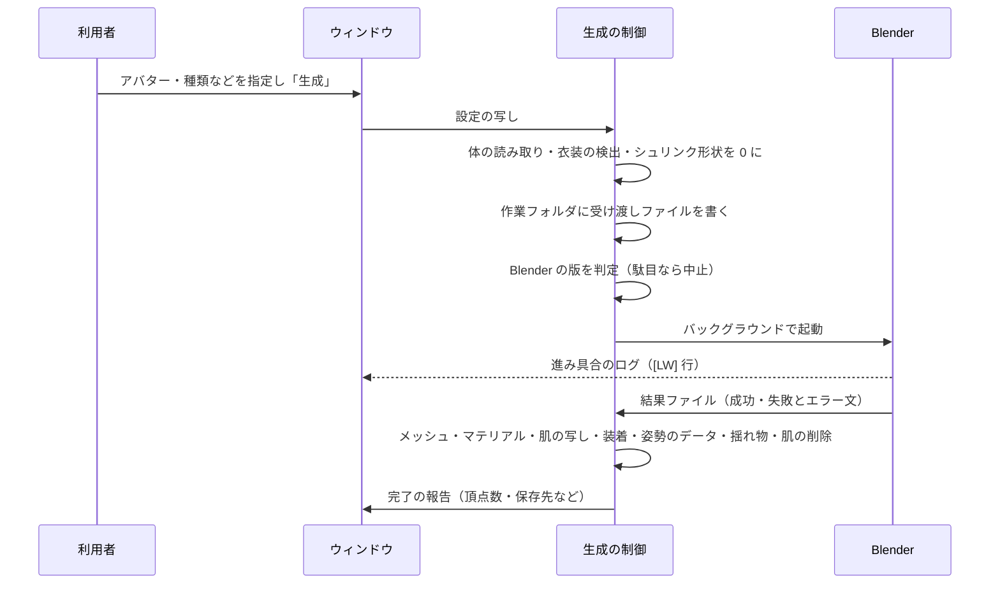

<!--
SPDX-FileCopyrightText: 2026 MerciaGrimauge
SPDX-License-Identifier: 0BSD OR MIT-0
-->

# LegWeaver ソフトウェア基本設計書

## 0. この文書について

- **位置づけ**: LegWeaver を、外から見た構成・機能・取り決めの単位でまとめた基本設計書です。
- **元にした資料**: 処理の詳細は次の 2 つの設計書にあり、本書はそれらを総合して全体像を示します。いずれもコードの写しを含まず、働きと取り決めを自分の言葉で書いています。
  - [algorithm_editor.md](algorithm_editor.md): エディター拡張（C#）と Blender 内の処理（Python）。以下「詳細設計 E」。
  - [algorithm_shader_runtime.md](algorithm_shader_runtime.md): シェーダーと実行時の部品。以下「詳細設計 S」。
  - 処理の仕様を実装できる粒度で網羅した `ALGORITHM.md` と、構成・流れ・状態を図にした `uml/`（説明は `uml/design_uml.md`）が同じフォルダに並びます。
- **書き方の決まり**: 本書もコードを写さず、働き・取り決め・数値の仕様だけを書きます。長さは特に断らない限り実寸（mm・m）です。

---

## 1. システムの概要

### 1.1 目的

VRChat などで使う Humanoid のアバターに、体の形にぴったり沿った脚・腕の衣類を自動で作り、着せる Unity エディター拡張です。

- **対象の衣類**: タイツ、スパッツ、サイハイ、ニーハイ、手袋、アームカバー、包む（体以外のメッシュ、たとえば脚の代わりの下半身を布で包む）、親指サック（タイツの下に着る補強）、ガーター（脚を一周する帯。リボンの結び目付き）、レッグラップ（脚にらせんに巻くリボン）。
- **基本の考え方**: 布は体の肌の面そのものを外へ押し出して作ります。布のどの頂点も肌の一点に結び付き、その点のボーンウェイトとシェイプキーを受け継ぐので、どの姿勢でも肌と同じように動きます。
- **見た目**: デニール（糸の太さ）に応じた透け、伸び・姿勢・視線の角度による透けの変化、実物の構造（帯・パンティ部・補強など）を再現します。

### 1.2 利用者と利用場面

- **利用者**: アバターを改変する人。3D の専門知識を前提にしません。
- **利用場面**: Unity エディター上でアバターを開き、ウィンドウで種類や色などを選んで生成し、そのままアップロードします。生成物はアバターの中に置かれ、ビルド時（アップロード時）に Modular Avatar・Avatar Optimizer・NDMF で仕上がります。

### 1.3 範囲外

- Humanoid でないアバター、体のメッシュに肌が無い所の衣類（警告のみ）。
- アバターごとの個別対応（処理はすべて汎用で、特定のアバター向けの分岐を持ちません）。
- 実行時（ゲーム中）の布の物理挙動（ガーターのリボンの垂れだけは、VRChat の揺れ物に任せます）。

---

## 2. 動作環境と前提

| 区分 | 内容 |
|---|---|
| OS | Windows（Blender の自動検出が Windows の登録情報と Program Files に依存） |
| Unity | 2022.3 系（VRChat の指定する版） |
| 必須パッケージ | VRChat SDK（Avatars。実行時の部品の印、リボンの揺れ物）、NDMF（ビルド時の処理とプレビュー）、Modular Avatar（骨格の結合・シェイプキー同期）、lilToon（同梱シェーダーの土台。読み込めなければ標準マテリアルで代用） |
| 任意パッケージ | Avatar Optimizer（無ければ隠れる肌を消さない） |
| 外部ソフト | Blender 5 以上（インストール版、またはポータブル版の場所を指定）。サポートの終わった版と、その同梱 Python がサポート外の版は使わない（詳細設計 E 2.4） |
| 通信 | 一切しない（サポート期限の表もツールに内蔵） |

---

## 3. システム構成

### 3.1 構成要素

```mermaid
flowchart LR
  subgraph Unity エディター
    W[ウィンドウ\n設定・警告] --> G[生成の制御]
    G --> R[体の読み取り\nボディ選択・骨・目印・足の指]
    G --> L[衣装の検出\n下に着る物・上に着る物\n小物の下の層]
    G --> J[受け渡しファイルの書き出し]
    G --> X[Blender の起動と監視\n版の判定・打ち切り]
    X --> M[メッシュの組み立て\nウェイト・シェイプキー・UV]
    M --> T[マテリアル・テクスチャ]
    M --> K[肌の写し]
    T --> I[装着\n骨の写し・MA の結線]
    I --> D[肌の削除\nAAO の箱]
    I --> P[姿勢の伸びのデータ]
    I --> Q[リボンの垂れ\n骨・揺れ物]
  end
  subgraph Blender（バックグラウンド）
    B[7 段の形状処理]
  end
  subgraph ビルド時・描画時
    F[肌を衣装に合わせる部品\n（ビルド時に働く）]
    S[カスタムシェーダー\n姿勢による透け・深度の先行パス]
  end
  J -- job.json / input.bin / under.bin --> B
  B -- output.bin / output.json --> M
  D -.-> F
  P -.-> S
```

| 要素 | 役割 | 詳細 |
|---|---|---|
| ウィンドウ | 対象・種類・見た目・構造・Blender の設定と、ボディの問題の警告 | 第 6 章 |
| 生成の制御 | 一回の生成の流れをまとめる。設定は開始時に写し、生成中の変更の影響を受けない | 詳細設計 E 2.2・2.6 |
| 体の読み取り | ボディメッシュの自動選択、骨の対応（衣装が自前の骨を持つ場合を含む）、目印の位置、足の指ごとの骨 | 詳細設計 E 3 |
| 衣装の検出 | 肌に沿って着ている物（下着など）を見つけ、その高さ・面・ウェイトを求める。上に着る物（靴下・靴）の天井も求める。小物では前に作った脚の衣類とアバターの脚の服を下の層にする | 詳細設計 E 8 |
| Blender 連携 | 検出、版の判定、起動・ログの中継・打ち切り | 詳細設計 E 2.3・2.4 |
| 形状処理（Blender） | 覆う範囲の切り出し、包絡面、肌から浮かせる、つま先、崩れの修正、部位分け、下の層への載せ、リボンの結び目、厚み | 詳細設計 E 4〜6 |
| メッシュの組み立て | 結果から Unity のメッシュを作り、肌の点のウェイトとシェイプキーを移す | 詳細設計 E 7 |
| マテリアル | デニールと部位に応じた透け、質感、柄のテクスチャ | 詳細設計 E 6 |
| 装着 | アバターの中に衣装を置き、骨を結ぶ | 詳細設計 E 7.5 |
| 肌の削除 | 布に隠れる肌を、ビルド時に AAO で消す箱を付ける | 詳細設計 E 7.7 |
| リボンの垂れ | 垂れに骨を連ね、VRChat の揺れ物を付ける | 詳細設計 E 7.8 |
| 実行時の部品 | 衣装の下に残した肌を、衣装のウェイトで動かす（ビルド時に適用） | 詳細設計 S 3 |
| シェーダー | 姿勢による透けの変化、重なりの描き方 | 詳細設計 S 2 |

### 3.2 ライセンスの区分

| 部分 | ライセンス |
|---|---|
| エディター拡張（C#）と Blender 内の処理（Python） | GPL-3.0-or-later |
| シェーダー、実行時の部品 | MIT |
| 外部設計書（処理の説明書 ALGORITHM.md、この文書、2 冊のアルゴリズム設計書、UML の図） | 0BSD と MIT-0 のどちらかを選べる |

Blender の Python API を使う処理は GPL の Blender の中で動くため GPL とし、アバターに入ってアップロードされる部分（シェーダー・実行時の部品）は MIT として、アバターの配布に GPL の条件が及ばないようにしています。

---

## 4. 機能一覧

| 分類 | 機能 | 要点 |
|---|---|---|
| 生成 | 10 種類の衣類 | 脚 4 種・腕 2 種・親指サック・ガーター・レッグラップは Blender で作る。包むは Blender を使わず、対象のメッシュを法線方向へずらして作る |
| 体 | ボディの自動選択 | 太ももと膝下の両方を覆うメッシュのうち、いちばん内側の物。手動指定も可 |
| 体 | 衣装の骨の読み替え | 体と別の骨を持つ衣装は、Modular Avatar の結合と同じ決まりで体の骨に対応付ける |
| 衣装 | 下に着る物の上に重ねる | 下着などを検出し、その上に布を作る（下着と一緒に動く） |
| 衣装 | 上に着る物の下に収める | 靴下・靴などの内側に布を収める |
| 衣装 | 小物の共通の扱い | ガーター・レッグラップは、前に作ったタイツ・靴下やアバター自身の脚の服の上に巻くか、服を無い物として素肌（タイツ）に巻くかを選べる。密着した服で覆われる所は作らない。帯は締まる物として隙間を 0.3 mm 以下に抑え、影を受けず、体のウェイトだけで動く |
| 形 | 実物の構造 | ウエストバンド・パンティ部・ランガード・つま先とかかとの補強・中心の縫い目・ひしマチ |
| 形 | つま先 | まとめ（指の間を埋める）／5 本指／足袋型（親指だけ分ける）。足の指ごとに骨を持つ体では、指の間を渡る布のウェイトをならす |
| 形 | 親指サック | 親指の付け根まで覆い、口はほかの指との境目に沿う。上に重ねる透けるタイツはサックの上に肌の写しを付けない |
| 形 | ガーター・レッグラップ | 帯の位置・幅、巻き始め・終わり・回数・幅・交差。股をまたがない位置へ自動で下げる。ガーターのリボンの結び目（2 つの羽根・2 本の垂れ） |
| 見た目 | デニールと透け | 視線の角度・伸び・姿勢・引っ張りによる透けの変化。2 層式・フェイクサイハイ |
| 見た目 | 柄と色 | プリセットの色、グラデーション、伝線、バックシーム・ドット・猫の柄、ソックスの口ゴム（レース・滑り止め）、フェイクサイハイの境目の飾り |
| 見た目 | 質感 | 標準・マット・セミグロス・光沢・サテン・トゥーン（手袋だけ綿も） |
| 肌 | 肌の写し | 透ける布の内側に肌を写し、下の肌を消しても透けて肌が見える |
| 肌 | 肌の削除 | 布に完全に隠れる肌をビルド時に消す（端から余裕を残す） |
| 肌 | シュリンク系シェイプキー | 衣装用に肌を縮めるシェイプキーを形で見分け、生成前に 0 にする |
| 警告 | ボディの問題 | 肌の欠け（腰・太ももの上、膝から下）、脚に描かれたタイツ、膝関節にかかるニーハイの口ゴム、Blender の未検出・サポート外 |

各機能の設定項目と範囲は、詳細設計 E 1.3 の表にあります。

---

## 5. 処理の流れ

### 5.1 一回の生成



- **待ち方**: Blender はバックグラウンドで動き、エディターは止まりません。ウィンドウはエディターの更新ごとにログを見て、進み具合を表示します。準備と組み立ては同期処理で、Blender の実行だけが非同期です。実行中は設定の区画が無効になります。
- **打ち切り**: 経過時間が上限（通常 60 秒、高品質 90 秒。利用者が変えられる）を超えたら Blender を止め、失敗として報告します。
- **後始末**: 作業フォルダ（体の生のメッシュを含む）は、成功・失敗・キャンセル・ウィンドウを閉じた時のどれでも消します。開始の途中で止まった時も消します。Blender を止めた直後で使用中のファイルは、Unity の終了時に一時フォルダごと消えます。

### 5.2 Blender 側の 7 段

1. **体を読む**: 頂点を位置で溶接し、目印と、覆う範囲を切る平面を作る。小物では帯の位置を股をまたがない所まで下げる。
2. **覆う範囲を切り出す**: 平面（親指サック・レッグラップは滑らかな形）で体の面を切り、必要な部分だけを残す。肌が途中までしか無い体の切り口はまっすぐに切りそろえる。指から離れた爪などの島は布にせず、その上の布を浮かせる量に使う。
3. **包絡面を作る**: 覆う範囲を閉じて距離場（SDF）にし、面にする。つま先は細かい格子で、指の間を埋める（足袋型は親指の側を開いてから作る）。お尻は谷を橋渡しする面を別に作る。
4. **肌から浮かせる**: 各頂点を肌の法線方向へ「隙間＋厚み（＋下着の高さ・関節の余裕・縁の浮かせ）」だけ出す。狭い溝、体の中心線、上に着る物の天井で制限する。指先・足の指は凸包へ膜のように張る。
5. **つま先を差し替える**: まとめ・足袋型では、指の付け根より先を包絡面の面に置き換え、縫い合わせる。
6. **仕上げる**: しわ・こぶ・折れを形で見つけてならし、部位を分け、下着の上の部分を下着の面から作り直す。小物は下の層の一番外の面に載せ、ガーターにはリボンの結び目を足す。
7. **厚みを付けて書き出す**: 縁にだけ厚みを付け、各頂点を体の三角形に結び付けて書き出す。品質の報告（尖り・浮きすぎ・細い三角形・穴など）を数える。

各段の式と定数は、詳細設計 E 3〜6 にあります。

---

## 6. 画面

ウィンドウは 1 つで、上から次の区画に分かれます。

| 区画 | 内容 |
|---|---|
| 対象 | アバター（シーン上の物かプレハブ）、ボディメッシュ（空欄で自動）、ボディの問題の警告 |
| 衣装 | 種類、色、質感、デニール、衣装の扱い、つま先、仕上がり、フェイクサイハイ、柄、2 層式、透け、実物の構造（折り畳み）、種類ごとの項目（ウエストの高さ・裾・上端・手袋の長さと指・帯や巻きの寸法など）、肌の扱い、詳細設定（折り畳み）。種類ごとに関係する項目だけを出し、関係しない項目は無効にする。包む種類では包むメッシュ（空欄で自動）と隙間・厚みだけを出す |
| Blender | blender.exe の場所、打ち切り時間（品質ごと）、同梱 Python の場所（任意）、版の判定結果と案内 |
| 実行 | 生成・キャンセル、進み具合、結果の文、ログの末尾（折り畳み。最大 15,000 文字） |

- **警告の出し方**: 生成を止めない問題（肌の欠け、描かれた脚、口ゴムの位置）は、該当する区画に警告を出すだけにします。生成できない問題（Humanoid でない、Blender が無い・サポート外）は、エラーとして生成を止めます（「生成」ボタンも無効にする）。
- **重い判定の扱い**: ボディの問題の判定と衣装の検出は重い処理なので、アバターやボディが変わった時だけ計算し、結果を覚えておきます。検出した衣装を「上に重ねる」かの選択は、アバター内の経路で覚えます（プレハブを配置しても残る）。

---

## 7. 外部とのやり取り

### 7.1 Blender との受け渡し

| ファイル | 向き | 内容 |
|---|---|---|
| job.json | Unity → Blender | 件数、1 単位あたりのメートル、各ファイルの場所、目印の位置、足の指ごとに骨を持つ体では頂点ごとの指の番号、衣類の設定（種類の識別子と、判定を済ませた数値・真偽値。種類に固有の項目はその種類の時だけ） |
| input.bin | Unity → Blender | 体の頂点・法線・UV・脚の重み・関節の混ざり・下着の高さ・上着の天井・三角形 |
| under.bin | Unity → Blender | 下に着ている物の面（体のメッシュ空間） |
| output.bin | Blender → Unity | 布の頂点・法線・体の UV・結び付けた体の三角形と重心座標・三角形・覆う距離・伸びの透過倍率・部位・脚の座標・下着の三角形と重心座標 |
| output.json | Blender → Unity | 成否、エラー文、件数、品質の報告、リボンの垂れの情報 |

- **大きさの検査**: どのファイルも、大きさが件数と正確に合わなければ失敗とします。三角形の番号が範囲外の時も失敗とします。
- **範囲の検査**: 計算の細かさ・隙間・厚みが、ウィンドウの許す範囲の外なら、Blender 側でも拒みます。手で書き換えた job で、メモリが足りなくなるのを防ぐためです。
- 並びと型の詳細は、詳細設計 E 10 にあります。

### 7.2 Blender の起動

- **起動のしかた**: 工場出荷時の設定で、バックグラウンドで起動し、スクリプトと job.json の場所を渡します。
- **スクリプトの探し方**: エディター用のアセンブリ定義の GUID から探します。名前で探すと、別のパッケージの同名のファイルを拾う恐れがあるためです。
- **使ってよい版**: 自分で見つけた物も指定された物も、「Blender の配置である」ことと、内蔵の表で Blender と同梱 Python のサポートが終わっていないこと（終了 90 日前から不可、180 日前から警告）を確かめます。

### 7.3 ほかのパッケージとの連携

| パッケージ | 使い方 |
|---|---|
| Modular Avatar | 衣装の骨格を体に結合する。シェイプキーを同期する。衣装の自前の骨を体の骨に読み替える決まりを借りる |
| Avatar Optimizer | 隠れる肌を、箱の範囲で消す部品を付ける |
| NDMF | 実行時の部品をビルド時に適用する。エディター上でプレビューする |
| lilToon | 布のマテリアル（透け・質感・柄）。姿勢による透けと深度の先行パスのカスタムシェーダー |
| VRChat SDK | 実行時の部品の「エディター専用」の印。ガーターのリボンの垂れの揺れ物（型は名前で探し、無ければ警告だけ） |

パッケージの有無は、アセンブリ定義の版の定義（Modular Avatar・Avatar Optimizer・lilToon）で見分け、無い物の機能は省きます。

### 7.4 シェーダーへ渡す値

- **頂点の値**: UV0 に伸びのマスク、UV1 に柄の座標、UV3 に姿勢の伸びの係数、UV4 に脚の座標、接線に「曲がりを測るベクトル」（立った姿勢で長さ 1）を入れます。
- **マテリアルの値**: 姿勢による透けの強さ（0 で無効）。
- 詳細は詳細設計 S 2 にあります。

---

## 8. 出力

### 8.1 アセット

`Assets/LegWeaver_Output/{アバター名}_{種類}_{デニール}D_{日付}_{時刻}/` に、次を保存します。
- 布のメッシュ
- 部位ごとのマテリアル
- テクスチャ（視線の角度による透け、伸びのランプ、柄）
- 肌の写しのメッシュとマテリアル

### 8.2 シーンの構成

- **置き場所**: 衣装のオブジェクト（必要な骨だけを写した骨格と、スキンメッシュ `…_Mesh`、肌の写し `…_Skin`）を、ボディのオブジェクトの下に置きます。ボディと一緒に表示・非表示が切り替わります。ただし、ボディがアバターのルートにある、均一でない拡大がされている、骨格の中にある、のどれかの場合はルートの下に置きます。
- **名前**: 衣装のオブジェクトは「種類のラベル_デニールD」（`Tights` `Spats` `ThighHighs` `KneeHighs` `Gloves` `ArmCovers` `ToeCaps` `Garters` `LegWraps` `Wrap`）。ガーター・レッグラップが前に作ったタイツ・靴下を見つける時、透けるタイツが親指サックの上に写しを付けない時、体の候補からこのツールの生成物を除く時に、この名前と出力フォルダの場所を手がかりにします。
- **包む種類**: 包む対象のオブジェクトの下に置きます（骨格は作らない）。
- **付ける部品**: Modular Avatar の衣装の結線とシェイプキー同期、AAO の削除の箱、肌を衣装に合わせる部品、リボンの垂れの骨と揺れ物を、必要に応じて付けます。
- **元に戻す**: 生成は Undo の対象です。追加したオブジェクトと部品を消せば元に戻ります。

---

## 9. 異常時の扱い

| 状況 | 扱い |
|---|---|
| Humanoid でない、必要な骨が無い | 生成を止め、理由を表示 |
| 指定したボディ・包む対象が、そのアバターのシーン上の子でない | 生成を止める（別のアバターやアセットを書き換えない） |
| ボディが見つからない | 生成を止め、手動の指定を案内 |
| 包むメッシュが見つからない | 生成を止め、ウィンドウでの指定を案内 |
| Blender が見つからない | インストールか、ポータブル版の指定を案内 |
| Blender・同梱 Python がサポート外（期限 90 日前を過ぎた物を含む） | 生成を止める。180 日前からは警告 |
| 打ち切り時間を超えた | Blender を止め、打ち切り時間を延ばすよう案内 |
| 結果が無い・失敗・大きさが合わない | エラー文を表示し、作業フォルダを消す |
| 開始の途中で失敗した | 作業フォルダを消してから理由を表示 |
| ボディにマテリアルが無い | 肌の写しを作らず、肌も消さない（警告をログに出す） |
| 肌の写しを作れなかった | 肌を消さない（透けて穴が見えるのを防ぐ） |
| VRChat SDK の揺れ物が無い | リボンの垂れは揺れない（警告のみ） |
| 肌の追従データが体のメッシュと合わない（ビルド時） | 何もせず警告だけ出す |

---

## 10. 非機能

| 項目 | 内容 |
|---|---|
| 性能 | Blender の処理は 1 体あたり通常 10〜40 秒。高品質は最大 30,000 三角形に収める。完了の報告でアバター全体の三角形数と VRChat の PC のポリゴン数のランクの目安を示す |
| 再現性 | 同じ入力（体・設定・Blender の版）からは同じ出力になる |
| 安全性 | 通信をしない。受け取るファイルは大きさと番号の範囲を検査する。アセットを書き換えず、シーン上の写しを変える。外部プログラムの起動は Blender だけで、配置と版を確かめてから使う。作業ファイルは専用の一時フォルダだけに書き、終わり方にかかわらず消す |
| 移植性 | Windows のみ（Blender の検出）。Unity 2022.3 系 |
| 保守性 | 個別のアバター向けの処理を持たない。処理の説明（ALGORITHM.md）と設計書・UML を保つ。部位の番号・UV の役割・シェーダー名とプロパティ・生成物の名前・追従データの並びを互換性として守る |
| 利用者の負担 | Blender の操作は不要。設定の多くは既定値のままで使える |

---

## 11. 制約と既知の課題

詳細設計 E 11 と詳細設計 S 4 の限界に加えて、見た目に関わる課題を挙げます。

| 課題 | 状況 |
|---|---|
| 股の一番下の小さなひれ・× | 布が股の谷の底で、体に無い鋭い折れを作ることがある。平滑化や谷の橋渡しの条件で減らしているが、体の作りによって残り方が違う |
| 後ろ腰の帯の縁の明るい三角形 | 後ろの上から見ると見えることがある。縁の浮かせで突き抜けは減るが、体によって歯のように残ることがある |
| つま先が指の形に見える | 主に、半透明の布越しに体の指が透けて見えるため |
| 体に肌が無い所・脚に描かれたタイツ | 汎用の処理では直せない。警告で知らせる |
| 小物と下の層のずれ | ガーター・レッグラップは体のウェイトだけで動くので、下のタイツが下着のウェイトで動く所では姿勢によってわずかにずれる |

---

## 12. 用語

| 用語 | 意味 |
|---|---|
| デニール（D） | 糸の太さ。小さいほど薄く透ける。30D は半透明、80D 以上はほぼ不透明 |
| 肌の写し | 透ける布の内側に描く、体の肌と同じ見た目の面 |
| 包絡面 | 覆う範囲を閉じて、一定の距離だけ外へ出した面（距離場から作る） |
| 脚の座標 | 股関節 0・膝 1・足首 2・つま先 3 とした、脚の骨に沿った位置。腕では肩 0・肘 1・手首 2 |
| 部位 | 実物のタイツで編み方の違う部分（脚・パンティ部・帯・補強・縫い目・ひしマチなど） |
| 姿勢の伸び | 関節を曲げた時に布が伸びて透ける度合い。接線の縮みから求める |
| 上に重ねる・下に収める | 下着などの上に布を作ること、靴下などの内側に布を収めること |
| 下の層 | ガーター・レッグラップを載せる、前に作った脚の衣類やアバター自身の脚の服 |
| 小物 | ガーター・レッグラップ（脚の衣類の上に付ける物） |
| 肌の追従データ | 下着の下に残す肌を下着と一緒に動かすための、頂点ごとの新しいウェイト。ビルド時に適用して取り除く |
